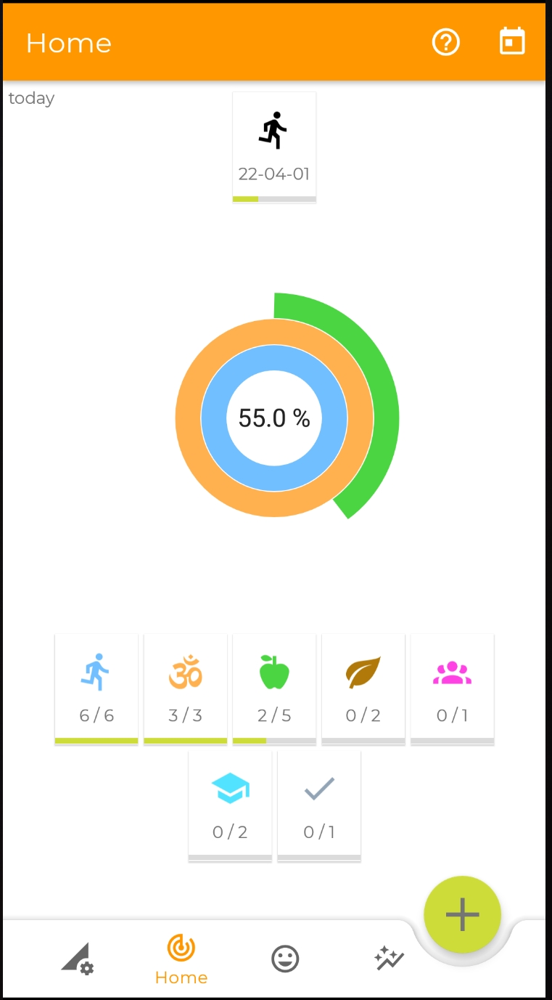
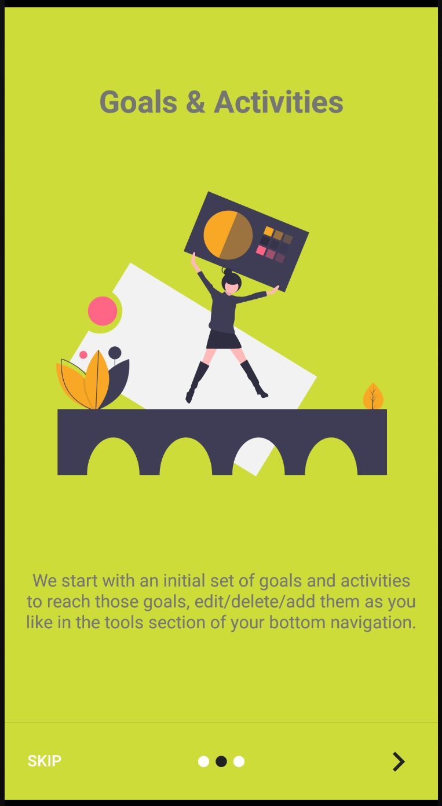
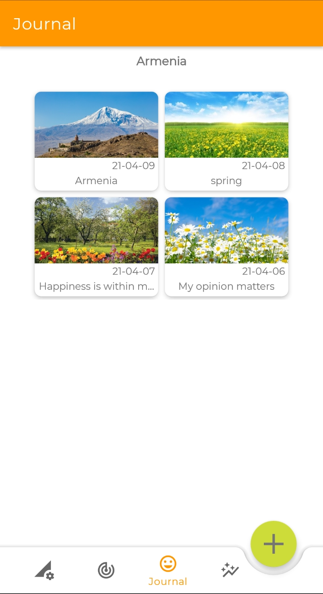
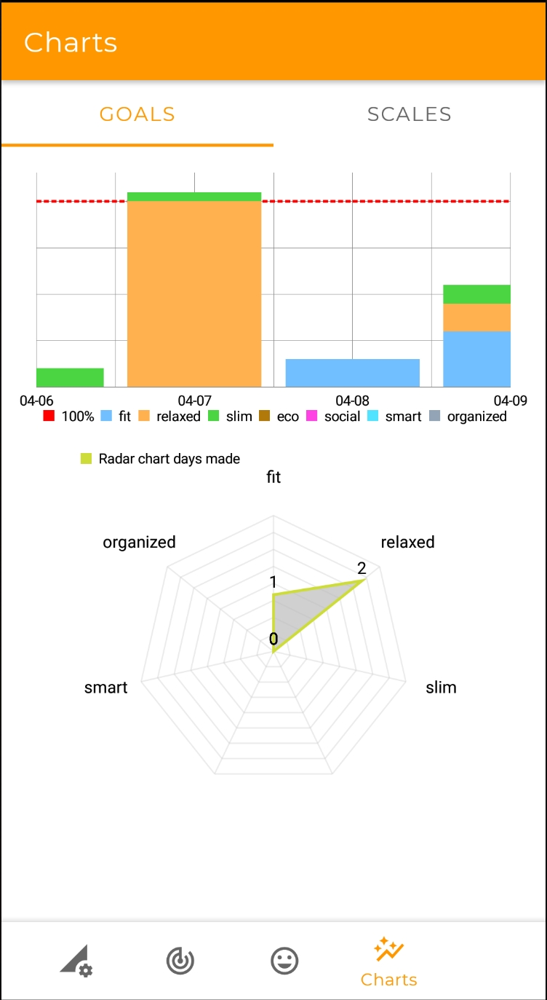
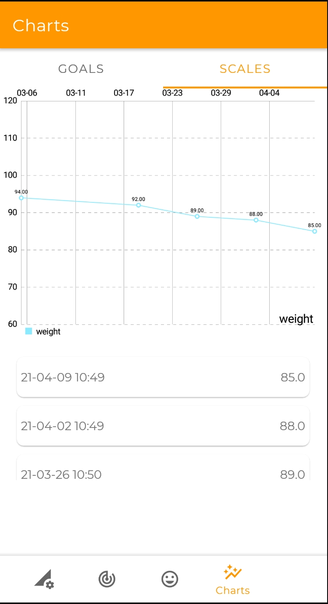
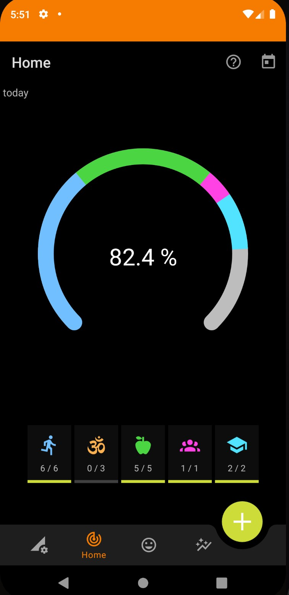

<h3 align="center">
  moreDays
  
</h3>

[](https://gitlab.com/wuapps/moredays/-/blob/master/LICENSE)
[](https://rubygems.org/gems/fastlane)
[](https://gitlab.com/wuapps/moredays/-/blob/master/CONTRIBUTING.md)

## Contribute to _moreDays_

Check out [CONTRIBUTING.md](CONTRIBUTING.md) for more information on how to help with _moreDays_.

## Code of Conduct

Help us keep _moreDays_ open and inclusive. Please read and follow our [Code of Conduct](https://gitlab.com/wuapps/moredays/-/blob/master/CODE_OF_CONDUCT.md).

## Vision -- [Video](https://youtu.be/xiJHfUTK0os)

moreDays is an app (<a href="https://play.google.com/store/apps/details?id=de.wuapps.moredays">google app store</a>) to reach your individual goals, even if the day is strenuous.
Make each day YOUR day, do what you really really want first and what you think you should do second.
Take each day a picture and some notes to remember each day.

Habit apps focus on a specific habbit. Often you fail, because you start highly motivated but the days are to strenuous to do your habits on a daily basis. moreDays is different, you start with your goals, how you want to be and then you define different activities to reach those goals, there is always more than one way, hence different activities for easy days and for strenuous days.

In addtion you may track your weight, your sleep quality or anything else you like to meassure.

With moreDays you can reflect your day in a personal journal, follow your goals. Everything is in your hand, just do it.
Make every day a good day :)

[](https://f-droid.org/packages/de.wuapps.moredays/)
[](https://play.google.com/store/apps/details?id=de.wuapps.moredays)








## Used technologies and libraries and general features

I developed this app to learn Android better, hence you will find example code for the following

- architecture components, room, viewmodels, livecycle, bottom navigation with navigation graph
- splash screen
- onboarding using the library https://github.com/jdsjlzx/AppIntro_guide
- tutorial with tap and ballons using https://github.com/KeepSafe/TapTargetView
- giving credentials to all used libraries automatically, using the library https://github.com/mikepenz/AboutLibraries
- charts using the library https://github.com/PhilJay/MPAndroidChart
- emojis in textviews and buttons
- selecting and showing icons using the library https://github.com/maltaisn/icondialoglib
- select an image and camera using https://github.com/OpenSooq/Gligar
- color picker using https://github.com/skydoves/ColorPickerView
- glide to show pictures (better performance) https://github.com/bumptech/glide
- konfetti using the library https://github.com/DanielMartinus/Konfetti
- animations with lottie https://github.com/airbnb/lottie-android and from https://lottiefiles.com/

### libs to be evaluated
- more pretty charts
  - https://github.com/AnyChart/AnyChart-Android
  - https://github.com/diogobernardino/WilliamChart

## Decisions

After playing with flows, repositories, livedata and reading about viewmodel life cycles, the following architecture seems to be the best for this app:

- daos return flows for lists and simple objects for one shot read
  - an observer attached to such a flow, will listen to all changes of all involved tables of the corresponding query, hence observers will be attached to queries adressing one table only
- as daos are interfaces already and the data will be stored on the phone only, there is no need for repository classes -- they are useful, if the data comes from an api AND room
- even if a device is rotated and ondestroy of an activity/fragment is called, a viewmodel remains, hence use livedata in viewmodels, let them be updated
- most viewmodels of this app will need constructor parameters, therefore we need viewmodel factory classes, alternatively we could use hilt (still thinking about it). However looking at the changes https://github.com/android/sunflower/commit/cd57be5ad686aaad30b3e560d9cd858c952ff5bf it seems much more to do than to gain ...

## naming convention

- ids in layouts
  - typeName, e.g. textViewPoints, imageButtonColor
  - fab (floatingActionButton)
  - better https://jeroenmols.com/blog/2016/03/07/resourcenaming/
- strings
  - lbl\_
  -

## Walkthrough

- new kotlin project based on template bottom navigation
- added fragments (template with ViewModel): Activity, Challenge, Goal, Journal, Trophy; und ActivityList, TrophyList... and adapter classes and packages (organize by feature)
- added dependencies
- code is similar to
  - https://github.com/google-developer-training/android-kotlin-fundamentals-apps/tree/master/TrackMySleepQualityFinal
  - https://github.com/android/sunflower
- added view binding https://developer.android.com/topic/libraries/view-binding
- added dao/entity classes
- added components to navigation graph
- adapted bottom navigation (menu and mainactivity)
- added libraries
- downloaded fonts from https://fonts.google.com/
- implemented features
- added splash as described in https://www.bignerdranch.com/blog/splash-screens-the-right-way/
- added leakcanary to debugImplementation and run it, see https://github.com/square/leakcanary
- added emojis
  - https://developer.android.com/guide/topics/ui/look-and-feel/emoji2
  - copied from https://emojipedia.org

## Lessons learned

- Dependency Injection (DI): a class should not create the dependencies, it needs, those dependencies should be provided through the constructor
  - a more generic approach should use dagger and hilt, see https://blog.mindorks.com/dagger-hilt-tutorial
- ViewModelProviders.Factory: gives a new instance if it is needed and only if it is needed, hence use it; if the ViewModel has a parameter in the constructor (see DI above), implement your own factory
- custom views see https://developer.android.com/codelabs/advanced-andoid-kotlin-training-custom-views and https://developer.android.com/training/custom-views/create-view
- notifications: first you need to set an alarm and define a receiver for it, that onreceive of this receiver may show a notification
## Kotlin

- https://kotlinlang.org/docs/reference
- Java to Kotlin converter: https://try.kotlinlang.org/
### Binding and ViewModels

- https://developer.android.com/topic/libraries/view-binding
- **_needs a generic layout tag in layout files_**, see https://developer.android.com/topic/libraries/data-binding/expressions
- the viewModel should not know the context, hence it provides the data without internationalization, however this may be done in the view, e.g.

```
android:text="@{@plurals/watering_next(viewModel.wateringInterval, viewModel.wateringInterval)}"
<!-- or -->
android:text="@{journalViewModel.getFormattedDate(@string/date_ymd)}"
```

- binding of edittext to number is a bit tricky, workaround use one way binding, see https://stackoverflow.com/questions/38982604/two-way-databinding-in-edittext
  - ` android:text="@={` + goalViewModel.goal.points}" `
  - do not forget to fetch the value before saving
  - better use number picker, as it is supported for two way binding, see https://developer.android.com/topic/libraries/data-binding/two-way#java
  - do not forget the = for two way binding, e.g. `android:text="@={goalViewModel.goal.name}" `
  - buttons/events: `android:onClick="@{() -> viewModel.onCounterButtonPressed()}"`
  - good article https://www.bignerdranch.com/blog/two-way-data-binding-on-android-observing-your-view-with-xml/
  - spinner is just a hassle to bind to: after binding there is an autoselection of the first item in the list, hence any preselection needs a hack
    - https://code.luasoftware.com/tutorials/android/android-two-way-data-binding-with-spinner/
    - https://wamae.medium.com/using-android-livedata-in-spinners-room-428de4238847
    - https://stackoverflow.com/questions/2562248/how-to-keep-onitemselected-from-firing-off-on-a-newly-instantiated-spinner
  - https://github.com/android/databinding-samples/tree/main/TwoWaySample
- ViewModels should not reference view/Android stuff and ViewModel shouldn’t be referenced in any object that can outlive the activity/fragment

#### Live Data vs. Flow

- see article https://medium.com/android-dev-hacks/exploring-livedata-and-kotlin-flow-7c8d8e706324
  - Livedata is used to observe data without having any hazel to handle lifecycle problems. Whereas Kotlin flow is used for continuous data integration and it also simplified the asynchronous programming.
  - Live data is an observable data holder class, Live data is lifecycle aware
  - use setvalue/postvalue to notify observers of changed value
    - setValue for MainThread
    - postValue for BackgroundThread

#### Notifications
First you need to set an Alarm. When the alarm is triggered, the BroadcastReceiver will receive the intent and can perform the desired action, such as showing a notification.
To show a notification, we need to first create a NotificationChannel and ask for permission, see
[Android AlarmManager: Scheduling Alarms and Displaying Notifications](https://medium.com/@arfinhosain/android-alarmmanager-scheduling-alarms-and-displaying-notifications-77f815e2638).

## Tests

Usually, you write one assert per test. However the test preparation is complex, hence I decided to integrate all tests of one method into one test.

If anything is missing, let me know :)

